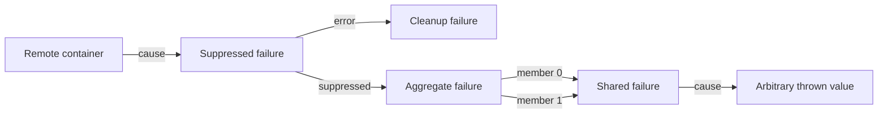
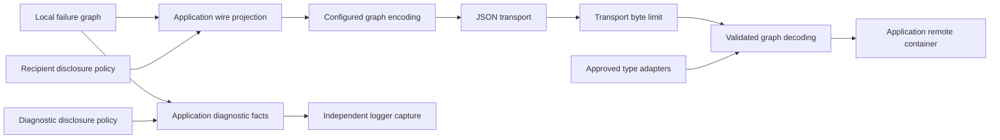

# ADR-0001: Error graph inspection and JSON reconstruction

## Status

Proposed. The requirements below are targets, not claims that the package
currently implements or verifies them. Decision status, implementation, and
evidence are separate.

## Context

### Background and Problem Statement

An error can relate to other failures through a cause, aggregate membership, or
suppression. These relations have different meanings. Causes can be arbitrary
thrown values, and error graphs can contain shared objects or cycles. A match
somewhere in a graph does not establish that the root has the same origin or
classification as the matched value.

Applications also need to carry selected failures across IPC boundaries. JSON is
the normal interchange format, but local instances, class identity, private
fields, and all graph topology do not automatically survive serialization.
Separate consumers use different envelopes, registries, fallback rules, and
disclosure policies. Transport failure, a malformed response, a local failure,
and a received remote failure are different outcomes. A timeout or missing reply
alone does not establish what the remote operation completed.

Applications can offer diagnostic facts to a logger without a dependency between
the error and logger packages. A logged projection is not necessarily a
reconstructible wire graph. Selecting a fact is not authorization to expose it.

### Example failure relationships

The following is one possible in-process graph. The remote container records a
received failure; the suppression node keeps a cleanup failure separate from a
prior aggregate failure. The two aggregate edges point to the same object. These
labels identify relations, not a rule that every remote error or cleanup failure
has this shape.

Walking the graph must distinguish the two aggregate edges from the shared
target. A cycle is also possible, although it is not shown. A receiver may
reconstruct selected relationships without preserving the original in-process
object identity; the selected JSON profile must state the loss.

### Interchange and observation boundaries

This diagram separates the proposed error-domain mechanisms from policy and
transport. It illustrates composition, not an existing wire protocol or a claim
that a remote operation completed.

The wire and diagnostic projections can differ even when they observe the same
failure. The logger is not an IPC encoder, and the decoder does not decide the
authority, origin, or completion of a remote operation. Transport authentication
and framing are not shown.

### Current Limitations

The existing [error base](../../src/AbstractError.ts) supplies class-directed
JSON conversion, but its decoder does not recursively reconstruct mixed error
graphs. The existing [matching helper](../../src/utils.ts) walks causes and
aggregate members, with cycle protection, but does not walk the two suppression
relations. Current consumers can build their own codecs, but repeated graph
handling and validation are difficult to implement consistently.

## Decision Drivers

### Primary Decision Drivers

- Preserve failure relationships without conflating their semantics.
- Share error-domain mechanisms while leaving boundary policy with its owner.
- Preserve existing APIs and existing consumer wire formats.

### Secondary Decision Drivers

- Support runtime-neutral JavaScript and TypeScript consumers.
- Avoid automatic traversal, serialization, and accidental disclosure.
- Make bounds, loss, unsupported values, and reconstruction explicit.

## Considered Options

### Option 1: Application-owned implementations only

**Description:** Every application implements its own traversal and JSON codec.

**Technical Characteristics:** Existing class conversion and matching remain
unchanged; policies and mechanics are implemented together by consumers.

**Advantages:** Existing APIs need no additions; policies stay local.

**Disadvantages:** Graph mechanics and edge-case tests are repeated.

**Risk Assessment:** Implementations may diverge or lose relationships.

### Option 2: Automatic universal serialization

**Description:** Automatically inspect and serialize every error and field.

**Technical Characteristics:** A single implicit representation decides what is
exposed and reconstructed.

**Advantages:** Minimal apparent configuration.

**Disadvantages:** Trust, class identity, effects, and consumer wire formats are
conflated.

**Risk Assessment:** High disclosure, compatibility, and availability risk.

### Option 3: Additive configured graph mechanisms

**Description:** Provide opt-in relation-aware inspection and a configurable
JSON graph codec while leaving boundary decisions to consumers.

**Technical Characteristics:** Existing class conversion and matching remain
unchanged. A graph codec has explicit type adapters and a declared profile.

**Advantages:** Reuses domain mechanics without coupling errors to logging or
transport.

**Disadvantages:** The graph representation, adapters, bounds, and compatibility
need explicit specification and testing.

**Risk Assessment:** Manageable only if unsupported values and trust boundaries
are not presented as automatically safe.

## Decision

Select option 3. The package owns reusable error relationships and configured
graph conversion. Applications and protocols own classification, permitted types
and fields, disclosure, envelopes, authentication, and remote provenance. The
package does not depend on a logger or transport.

### Generic mechanisms and boundary policy

The reusable error mechanisms are relation-aware inspection, class-directed JSON
conversion, and reconstruction using explicitly approved classes and supported
native error forms. Ordinary application error classes should be able to reuse
their existing class conversion without a separate custom codec for each class.
An extension point can handle constructors or representations that differ from
the ordinary class contract.

Applications compose these mechanisms with their own JSON envelope, field
selection, unknown-type policy, and transport-specific bounds. The package need
not impose a universal error wire envelope or supply a general-purpose JSON
value sanitizer. Where a generic traversal or codec has limits or cycle
behavior, its contract must state them; these do not replace transport-specific
byte limits or recipient-specific disclosure policy.

The default application-error representation starts from the existing
class-directed shape. Applications can choose another shape when required for an
existing protocol. That shape cannot by itself distinguish an intended error
from ordinary data that happens to have the same fields. A boundary requiring an
unambiguous distinction must supply its own tagging or decoding policy. Native
errors, aggregate and suppression relations, and arbitrary thrown values need
explicit documented handling.

### REQ-ERROR-GRAPH-COMPAT-001 Preserve existing behavior

- Requirement status: target
- Normative level: MUST
- Verification class: existing matching and class JSON regression tests
- Evidence status: unevidenced

The new mechanisms MUST be opt-in and MUST NOT change the existing matching
helper or class-directed JSON conversion behavior. Existing RPC and application
wire formats MUST NOT be silently replaced by the new profile.

### REQ-ERROR-GRAPH-RELATIONS-001 Preserve relation meanings

- Requirement status: target
- Normative level: MUST
- Verification class: cause, aggregate, suppression, and arbitrary-value cases
- Evidence status: unevidenced

Inspection MUST distinguish a cause, an ordered aggregate member, a suppression
error, and a suppressed prior failure. It MUST expose enough parent and relation
information for a caller to tell how a value was reached. Arbitrary thrown
values MUST be representable without treating them as error instances.

### REQ-ERROR-GRAPH-IDENTITY-001 Bound graph inspection

- Requirement status: target
- Normative level: MUST
- Verification class: cycles, shared objects, early stop, and deep graphs
- Evidence status: unevidenced

Inspection MUST terminate on repeated object identities, expose repeated
relations without treating equal primitive values as shared objects, and allow
callers to stop without inspecting later descendants. It MUST document traversal
order, depth and work limits, and whether each repeated relation identifies a
cycle or a shared target.

### REQ-ERROR-GRAPH-EFFECTS-001 Declare inspection effects

- Requirement status: target
- Normative level: MUST
- Verification class: getters, proxies, custom iterators, and absent globals
- Evidence status: unevidenced

Inspection MUST NOT read diagnostic fields or invoke JSON hooks merely to walk
relationships. It MUST document which relation accesses may execute user code,
how exceptions propagate or are reported, and behavior when a native suppression
constructor is unavailable. It MUST NOT assume foreign-realm identity from a
matching name.

### REQ-ERROR-JSON-PROFILE-001 Declare graph JSON representation

- Requirement status: target
- Normative level: MUST
- Verification class: nested native, aggregate, suppressed, and custom errors
- Evidence status: unevidenced

The opt-in codec MUST define a JSON-compatible representation, preserve the
selected relationship kinds and aggregate order, and start supported application
errors from the existing class-directed representation. Any graph envelope or
native-error encoding MUST be explicit and MUST NOT imply compatibility with a
consumer's existing wire schema. The codec MUST document round-trip loss.

### REQ-ERROR-JSON-CLASS-001 Reuse class-directed conversion

- Requirement status: target
- Normative level: MUST
- Verification class: registered classes, custom constructors, and nested causes
- Evidence status: unevidenced

The shared mechanism MUST allow approved application error classes to reuse
their class-directed conversion without requiring an equivalent custom codec for
each ordinary class. Custom constructor and representation strategies MUST
remain possible. The mechanism MUST document when class hooks execute and how
their failures propagate.

### REQ-ERROR-JSON-NATIVE-001 Declare supported native forms

- Requirement status: target
- Normative level: MUST
- Verification class: standard native, aggregate, and suppressed errors
- Evidence status: unevidenced

The shared mechanism MUST declare and reconstruct its supported native error
forms without silently changing a supported type. It MUST document behavior when
a runtime lacks a constructor and when a native or foreign type is unsupported.

### REQ-ERROR-JSON-TYPES-001 Use explicitly configured reconstruction

- Requirement status: target
- Normative level: MUST
- Verification class: known, unknown, malformed, and custom-constructor cases
- Evidence status: unevidenced

Decoding MUST validate the selected representation and use caller-approved type
identifiers and class adapters. It MUST NOT instantiate an arbitrary class from
a remotely supplied name. Unknown types, arbitrary values, constructor failures,
and invalid fields MUST have documented, explicit outcomes.

### REQ-ERROR-JSON-LIMITS-001 Define identity and resource limits

- Requirement status: target
- Normative level: MUST
- Verification class: cycles, sharing, size, depth, and malformed inputs
- Evidence status: unevidenced

The shared mechanism MUST define cycle and shared-reference behavior and any
graph limits it enforces, and MUST report rejection or loss explicitly.
Transport owners MUST apply the limits needed for their boundary, including a
byte limit before parsing untrusted input. A generic graph mechanism is not by
itself a general-purpose JSON validator or a transport security policy.

### REQ-ERROR-BOUNDARY-POLICY-001 Keep disclosure with boundary owners

- Requirement status: target
- Normative level: MUST
- Verification class: independent logging and wire policy cases
- Evidence status: unevidenced

The package MUST NOT treat generic serialization, observer demand, or class
reconstruction as permission to disclose fields. Callers MUST explicitly choose
their recipient-specific projection and handle provenance, transport security,
and failure classification outside the generic graph mechanism.

## Consequences

### Positive

- Consumers can reuse graph mechanics while owning distinct boundary policies.
- The error and logger packages remain independently usable.

### Negative

- A generic codec cannot guarantee safe use of arbitrary getters, hooks, or
  hostile synchronous callbacks, nor replace transport-level limits.
- New APIs and tests add maintenance and compatibility obligations.

### Neutral

- Existing wire formats require explicit migration decisions if consumers adopt
  the new profile.

## Decision Outcome

Add opt-in graph inspection and configurable JSON graph conversion, subject to
the requirements above. The exact public names and wire profile are selected by
the implementation and reviewed against the stated requirements.

## Related Decisions

- None.

## Links

- [Current error base](../../src/AbstractError.ts).
- [Current matching helper](../../src/utils.ts).
- [Current error tests](../../tests/unit/index.test.ts).

## More Information

The application is responsible for avoiding secrets in error values and for
separately projecting trusted diagnostics and externally disclosed responses.
The codec is not a logger, RPC runtime, universal object serializer, or sandbox.

### Proposed revision: matching and runtime capabilities

The owner has requested removal of the existing matching helper. This proposed
revision supersedes the portion of REQ-ERROR-GRAPH-COMPAT-001 requiring that
helper to remain unchanged. Removal is a breaking public API change; migration
must describe the iterator's different traversal order, suppression relations,
and identity semantics. Existing class-directed JSON behavior and existing
consumer wire formats remain unchanged unless separately migrated.

The application must provide the standard suppression constructor, either via
the runtime or an application-owned polyfill. This revision supersedes the
earlier expectation of graceful inspection when the constructor is unavailable.
It does not require the library to install or implement a polyfill.

The class-directed default profile does not implement the kernel or RPC wire
format. Further format-independent conversion needs concrete consumer examples
and review before it becomes a package contract.

### Proposed revision: parameterized class conversion

The class's existing `toJSON` and `fromJSON` methods accept cause-graph
conversion callbacks. With no callback, they use the package's default
conversion. The graph utilities supply callbacks that share their traversal
state. An override must forward or use that callback when it wants the same
recursive handling; custom constructors and application-owned conversion remain
possible. The first `toJSON` argument remains the key supplied by JSON
serialization; its optional cause-graph encoder is the second argument.

This revision supersedes the earlier statement that class-directed JSON behavior
remains unchanged. Direct class JSON conversion now recursively processes
supported cause graphs. This is a breaking behavioral and override-contract
change and requires migration. A cause graph can include aggregate membership
and suppression relationships; those edges do not all imply causation. Class
names are identifiers, not authority to instantiate untrusted input.

The graph encoder accepts an optional set of already-active error ancestors.
Direct class conversion seeds it with the class instance so a cycle back to the
root is rejected before invoking its hooks again. This is traversal state, not a
disclosure or input-validation policy. The class and utility modules refer to
each other, but defer their use of imported values until an operation is called;
both Node and the supported browser bundle must verify that initialization
works. The decoder's additional registrations do not disable built-in decoders,
so a boundary must enforce its own complete input allowlist before
reconstruction.

## Audit

### 2026-11-24

**Status:** Pending

**Findings:**

| Finding                                         | Files | Lines | Assessment |
| ----------------------------------------------- | ----- | ----- | ---------- |
| Graph inspection and codec await implementation | -     | -     | pending    |

**Summary:** The proposed decision records target behavior; implementation and
evidence have not yet been reviewed.

**Action Required:** Implement the selected additive mechanisms and attach
appropriate tests and review evidence.

### 2026-11-25

**Status:** Pending

**Findings:**

| Finding                                                                          | Files | Lines | Assessment |
| -------------------------------------------------------------------------------- | ----- | ----- | ---------- |
| Owner requested matching API removal and application-provided runtime capability | -     | -     | pending    |
| Consumer-specific JSON composition remains to be demonstrated                    | -     | -     | pending    |

**Summary:** The proposed revision records a breaking matching API change and an
explicit runtime capability requirement. The original proposed targets and
earlier audit remain as history.

**Action Required:** Review the revision, verify migration and runtime behavior,
and compare concrete consumer-format composition before accepting the decision.

### 2026-11-25

**Status:** Pending

**Findings:**

| Finding                                                                 | Files | Lines | Assessment |
| ----------------------------------------------------------------------- | ----- | ----- | ---------- |
| Class conversion now delegates cause handling through callbacks         | -     | -     | pending    |
| Existing class overrides require migration and concrete consumer review | -     | -     | pending    |

**Summary:** The candidate uses parameterized existing class methods rather than
introducing separate public node hooks. The change requires review and evidence.

**Action Required:** Verify default and custom class conversion, callback
propagation, cycle handling, browser behavior, and downstream migration.
